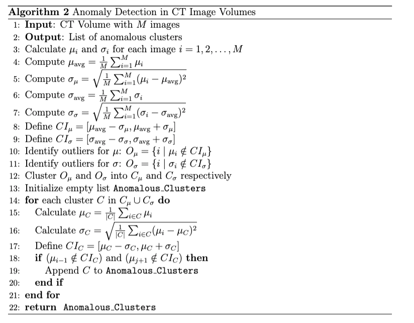

# CT_Images

[](https://processing.org/)


## 1. Introduction

### 1.1 CT window

The original CT image data have pixels with gray scale value ranging from 0-2000. However, the image file only support
256 levels of gray scale. Thus, an interval should be selected to parse the CT image data, such as [500,755]. The pixels
having value less than 500 will be parsed to 0, those having value greater than 755 will be parsed to 255.

### 1.2 CT volume and mutate CT images

CT-volume is a set of continuous images collected. In a single CT volume, the images should have same CT window.
Manually collected CT volume may have different CT window, which is caused by human error. The most general case is
small clusters of images having mutate CT window in a CT volume, which can be identified by human eyes. (Those images
here refer as "mutate CT images")

## 2. The Program

### 2.1 Core Methodology

The **CT_Images** application identifies differences in CT window settings by analyzing the average and standard deviation of pixel grayscale values, as well as the grayscale histogram of each image. Images with mutated CT window settings exhibit significant deviations in these statistical measures. The algorithm employs the following steps to detect and validate anomalous images:

1. **Attribute Calculation**:
   - Calculate the average and standard deviation of pixel grayscale values for each image.

2. **Outlier Identification**:
   - Construct confidence intervals based on the overall average and standard deviation of these attributes across the CT volume.
   - Identify images whose attributes fall outside these confidence intervals as potential outliers.

3. **Clustering of Outliers**:
   - Group consecutive outlier images into clusters to account for sequential anomalies.

4. **Cluster Validation**:
   - For each cluster, calculate the mean and standard deviation of its attributes.
   - Construct new confidence intervals using these cluster-specific statistics.
   - Verify the continuity of clusters by checking if adjacent images lie within the newly constructed intervals.
   - Confirm clusters as genuine anomalies only if they significantly deviate from their neighboring images.

#### Algorithm Details

##### 1. Attribute Calculation

For each image within a CT volume, the algorithm calculates two primary attributes:

- **Average Pixel Intensity ($\mu$)**: Represents the mean grayscale value of all pixels in the image.
- **Standard Deviation of Pixel Intensity ($\sigma$)**: Measures the variability of pixel intensities around the mean.

Mathematically, these attributes are defined as:

$$
\mu = \frac{1}{N} \sum_{i=1}^{N} x_i
$$

$$
\sigma = \sqrt{\frac{1}{N} \sum_{i=1}^{N} (x_i - \mu)^2}
$$

where $N$ is the total number of pixels in the image, and $x_i$ is the intensity of the $i$-th pixel.

##### 2. Outlier Identification

To identify anomalous images, the algorithm employs statistical confidence intervals based on the computed attributes.

**Confidence Interval Construction:**

For both average pixel intensity and standard deviation, confidence intervals are established:

- **For Average Pixel Intensity**:

$$  
  CI_{\mu} = [\mu_{\text{avg}} - \sigma_{\mu}, \mu_{\text{avg}} + \sigma_{\mu}]
$$


$$
CI_{\sigma} = [\sigma_{\text{avg}} - \sigma_{\sigma}, \sigma_{\text{avg}} + \sigma_{\sigma}]
$$

where $\mu_{\text{avg}}$ and $\sigma_{\text{avg}}$ are the overall means of the averages and standard deviations across the CT volume, respectively, and $\sigma_{\mu}$ and $\sigma_{\sigma}$ are their corresponding standard deviations.

**Identification of Outliers:**

An image is classified as an outlier if its average pixel intensity or standard deviation falls outside the respective confidence intervals:

$$
x \notin CI_{\mu} \quad \text{or} \quad x \notin CI_{\sigma}
$$

where $x$ represents the attribute value (either $\mu$ or $\sigma$) of an image.

##### 3. Clustering of Outliers

Outlier images often appear in sequences due to consecutive errors in window settings. To effectively identify these patterns, the algorithm groups consecutive outliers into clusters.

```java
// Pseudocode for Clustering Outliers
List<List<Integer>> clusterOutliers(List<Integer> outliers) {
    List<List<Integer>> clusters = new ArrayList<>();
    List<Integer> currentCluster = new ArrayList<>();
    
    for (int index : outliers) {
        if (currentCluster.isEmpty()) {
            currentCluster.add(index);
        } else if (index == currentCluster.get(currentCluster.size() - 1) + 1) {
            currentCluster.add(index);
        } else {
            clusters.add(new ArrayList<>(currentCluster));
            currentCluster.clear();
            currentCluster.add(index);
        }
    }
    
    if (!currentCluster.isEmpty()) {
        clusters.add(currentCluster);
    }
    
    return clusters;
}
```


##### 4. Cluster Validation

Not all clusters of outliers indicate true anomalies. To differentiate between genuine errors and structural variations, the algorithm performs a validation step.

**Attribute Analysis within Clusters:**

For each cluster, calculate the mean ($\mu_C$) and standard deviation ($\sigma_C$) of its attributes.

**Confidence Interval Reconstruction:**

$$
CI_C = [\mu_C - \sigma_C, \mu_C + \sigma_C]
$$

**Continuity Check:**

- Examine the pixel attributes of images immediately preceding and following the cluster.
- If neighboring images lie outside the reconstructed confidence interval $CI_C$, the cluster is confirmed as a genuine anomaly.

**Anomaly Confirmation:**

Only clusters that fail the continuity check are marked as anomalous clusters.

```java
// Pseudocode for Cluster Validation
boolean validateCluster(List<Integer> cluster, List<Double> averages, List<Double> stdDevs) {
    double clusterMean = 0;
    double clusterStd = 0;
    for (int index : cluster) {
        clusterMean += averages.get(index);
    }
    clusterMean /= cluster.size();
    
    for (int index : cluster) {
        clusterStd += Math.pow(averages.get(index) - clusterMean, 2);
    }
    clusterStd = Math.sqrt(clusterStd / cluster.size());
    
    double lowerBound = clusterMean - clusterStd;
    double upperBound = clusterMean + clusterStd;
    
    int prevIndex = cluster.get(0) - 1;
    int nextIndex = cluster.get(cluster.size() - 1) + 1;
    
    boolean isPrevAnomaly = false;
    boolean isNextAnomaly = false;
    
    if (prevIndex >= 0) {
        double prevAvg = averages.get(prevIndex);
        if (prevAvg < lowerBound || prevAvg > upperBound) {
            isPrevAnomaly = true;
        }
    }
    
    if (nextIndex < averages.size()) {
        double nextAvg = averages.get(nextIndex);
        if (nextAvg < lowerBound || nextAvg > upperBound) {
            isNextAnomaly = true;
        }
    }
    
    return isPrevAnomaly || isNextAnomaly;
}
```
### Overall Pseudo Code



## 2.2 Build, Run, and Use the Program

### 2.2.1 Build and Run

The program utilizes the Processing library to load and display CT images. Follow these steps to build and run the application:

1. **Download Processing 2.x**:
   - Ensure you have the Processing 2.x library installed. Download it from the [Processing Downloads](https://processing.org/download/) page if not already installed.

2. **Clone the Repository**:
   ```bash
   git clone https://github.com/Cyfine/CT_Images.git
   cd CT_Images
   ```

3. **Set Up the Environment**:
   - Ensure you have Java Development Kit (JDK) version 1.8 or higher installed.
   - Add the Processing 2.x library to your project's build path.

4. **Dependencies**:
   - The project relies on the following libraries:
      - **Apache Commons IO** (`commons-io-2.10.0.jar`)
      - **JSON-Java** (`json-java.jar`)
      - **Core Library** (`core.jar`)
   - Ensure these JAR files are located in the `lib/` directory.

5. **Compile the Project**:
   - Use your preferred Java IDE (e.g., IntelliJ IDEA, Eclipse) to import the project.
   - Ensure that the `lib/` directory is included in the project's build path.

6. **Run the Application**:
   - Execute the `runJar.bat` script (on Windows) or the equivalent shell script on Unix-based systems to run the application.
     ```bash
     java -jar CT_Images.jar
     ```

### 2.2.2 Usage

The program provides a command-line interface (CLI) for interacting with CT image volumes. Below are the primary commands and their usage:

#### Load

Loads CT image volumes from a specified directory.

```bash
load [path]
```

**Example**:

```bash
load home/User/Pictures/CT_images
```

**Directory Structure Supported**:

```
CT_images
│
├── HEP0001
│   ├── Se2Im30.jpg
│   ├── Se2Im31.jpg
│   └── ...
├── HEP0002
│   ├── Se3Im05.jpg
│   ├── Se3Im06.jpg
│   └── ...
└── ...
```

The `load` command automatically identifies and loads all CT volumes and their corresponding JSON tags from the provided directory into memory.

#### Analyze

Performs anomaly detection on the loaded CT volumes.

```bash
analyze
```

**Description**:

- Initiates the analysis process, where each `Analyzer` instance processes a CT volume in a separate thread.
- Upon completion, results are printed to the console and can be exported as CSV files.

#### Show

Displays a specific image from a CT volume using the `ImageViewer` component.

```bash
show [volume_index] [image_index]
```

**Example**:

```bash
show 0 10
```

- `volume_index`: Index of the CT volume (starting from 0).
- `image_index`: Index of the image within the selected volume (starting from 0).

#### Output

Exports analysis results or tagged images based on the provided options.

```bash
output [options]
```

**Options**:

- `-i`: Export images with detected anomalies.
- `-a`: Export all analysis results as CSV files.

**Example**:

```bash
output -i -a
```

This command exports both the annotated images and the analysis CSV reports to the specified output directories.

#### List

Lists all loaded CT volumes or filters them based on a keyword.

```bash
list [keyword]
```

**Example**:

```bash
list HEP0001
```

- Without a keyword, lists all loaded CT volumes.
- With a keyword, filters and lists volumes containing the keyword in their name.

#### Help

Displays help information for all available commands.

```bash
help
```

## 3. Algorithm

### 3.1 Attribute Calculation

For each image within a CT volume, the algorithm calculates two primary attributes:

- **Average Pixel Intensity ($\mu$)**: Represents the mean grayscale value of all pixels in the image.
- **Standard Deviation of Pixel Intensity ($\sigma$)**: Measures the variability of pixel intensities around the mean.

These attributes are computed by iterating through each pixel in the image and performing the necessary calculations.

```java
// Function to calculate average and standard deviation
public List[] calAttribute(List<PImage> images) throws InterruptedException {
    // Initialize threads for parallel processing
    ImgAttributeCal[] threads = new ImgAttributeCal[images.size()];
    LinkedList<Double> standardDeviation = new LinkedList<>();
    LinkedList<Double> average = new LinkedList<>();
    LinkedList<int[]> histPlot = new LinkedList<>();

    for (int i = 0; i < images.size(); i++) {
        threads[i] = new ImgAttributeCal(images.get(i));
    }

    for (int i = 0; i < images.size(); i++) {
        threads[i].start();
    }

    for (int i = 0; i < images.size(); i++) {
        threads[i].join();
    }

    for (int i = 0; i < images.size(); i++) {
        standardDeviation.add(threads[i].standDeviation);
        average.add(threads[i].average);
        histPlot.add(threads[i].histPlot);
    }

    return new LinkedList[]{average, standardDeviation, histPlot};
}
```

### 3.2 Outlier Identification

After calculating the attributes, the algorithm determines which images fall outside the established confidence intervals.

```java
public void mutateClusterSelect() {
    List<Double> imgAvg = (List<Double>) attrib[0];
    List<Double> imgSD = (List<Double>) attrib[1];

    List<List<Integer>> avgOverRange = new LinkedList<>();
    List<List<Integer>> sdOverRange = new LinkedList<>();

    imgAvg_avg = average(imgAvg);
    imgAvg_sd = sd_pop(imgAvg, imgAvg_avg);

    imgSD_avg = average(imgSD);
    imgSD_sd = sd_pop(imgSD, imgSD_avg);

    double imgAvg_upperbound = imgAvg_avg + imgAvg_sd;
    double imgAvg_lowerbound = imgAvg_avg - imgAvg_sd;

    double img_sd_upperbound = imgSD_avg + imgSD_sd;
    double img_sd_lowerbound = imgSD_avg - imgSD_sd;

    boolean img_Avg_adjacent = false;
    int avg_clusterIdx = -1;
    boolean img_SD_adjacent = false;
    int sd_clusterIdx = -1;

    // Select out-of-range images using average
    for (int i = 0; i < attrib[1].size(); i++) {
        if (imgAvg.get(i) < imgAvg_lowerbound || imgAvg.get(i) > imgAvg_upperbound) {
            if (img_Avg_adjacent) {
                avgOverRange.get(avg_clusterIdx).add(i);
            } else {
                img_Avg_adjacent = true;
                avgOverRange.add(new LinkedList<>());
                avgOverRange.get(++avg_clusterIdx).add(i);
            }
        } else {
            img_Avg_adjacent = false;
        }

        // Select out-of-range images using standard deviation
        if (imgSD.get(i) < img_sd_lowerbound || imgSD.get(i) > img_sd_upperbound) {
            if (img_SD_adjacent) {
                sdOverRange.get(sd_clusterIdx).add(i);
            } else {
                img_SD_adjacent = true;
                sdOverRange.add(new LinkedList<>());
                sdOverRange.get(++sd_clusterIdx).add(i);
            }
        } else {
            img_SD_adjacent = false;
        }
    }

    List<List<List<Integer>>> result = new LinkedList<>();
    result.add(avgOverRange);
    result.add(sdOverRange);
    clusters = result;
}
```

### 3.3 Clustering of Outliers

Consecutive outlier images are grouped into clusters to account for sequential anomalies. This step helps in distinguishing between sporadic outliers and systematic errors affecting multiple consecutive images.

```java
private void mutateClusterSelect() {
    // ... previous code ...

    for (List<Integer> clusterIdx : avgCluster) {
        if (clusterIdx.size() == 1) {
            avg_mutateCluster.add(clusterIdx);
            continue;
        }

        List<Double> cluster = parIdxToVal(clusterIdx, true);
        double avg = average(cluster);
        double sd = sd_sam(cluster, avg);

        int clusterHeadIdxPrev = clusterIdx.get(0) - 1;
        int clusterTailIdxFollow = clusterIdx.get(1) + 1;
        boolean headMutate = false;
        boolean tailMutate = false;

        if (clusterHeadIdxPrev > 0 && ((Double) attrib[0].get(clusterHeadIdxPrev) < cluster.get(0) - sd
                || (Double) attrib[0].get(clusterHeadIdxPrev) < cluster.get(0) + sd)) {
            headMutate = true;
        }

        if (clusterTailIdxFollow < attrib[0].size() && ((Double) attrib[0].get(clusterTailIdxFollow) > cluster.get(cluster.size() - 1) + sd ||
                (Double) attrib[0].get(clusterTailIdxFollow) > cluster.get(cluster.size() - 1) - sd)) {
            tailMutate = true;
        }

        if (headMutate || tailMutate) {
            avg_mutateCluster.add(clusterIdx);
        }
    }

    // Repeat for standard deviation clusters
    // ... similar code ...
}
```

### 3.4 Cluster Validation

Validates each cluster by checking the continuity of attributes with adjacent images. Only clusters that fail this continuity check are confirmed as genuine anomalies.

```java
private void clusterAnalysis() {
    // ... previous code ...

    for (List<Integer> clusterIdx : avgCluster) {
        // ... previous code ...

        if (headMutate || tailMutate) {
            avg_mutateCluster.add(clusterIdx);
        }
    }

    // Repeat for standard deviation clusters
    // ... similar code ...
}
```

## 4. Project Structure

```
CT_Images/
├── src/
│   ├── edu/
│   │   └── hkbu/
│   │       ├── app/
│   │       │   ├── Analyzer.java
│   │       │   ├── Test.java
│   │       │   └── runApp.java
│   │       ├── util/
│   │       │   ├── io/
│   │       │   │   ├── FileWriter.java
│   │       │   │   ├── FileReader.java
│   │       │   │   └── JSONProcessor.java
│   │       │   └── imageutil/
│   │       │       ├── DHash.java
│   │       │       ├── ImageViewer.java
│   │       │       └── ImgAttributeCal.java
│   │       └── util/
│   │           └── stringutil/
│   │               ├── StringUtils.java
│   │               └── Tokenizer.java
├── lib/
│   ├── commons-io-2.10.0.jar
│   ├── json-java.jar
│   └── core.jar
├── resources/
│   └── JetBrainsMono-Regular.ttf
├── runJar.bat
├── README.md
└── CT_Images.jar
```

## 5. Dependencies

Ensure you have the following dependencies installed:

- **Processing 2.x**: The core library for image processing.
- **Java Development Kit (JDK) 1.8 or higher**: Required for compiling and running the Java application.
- **Apache Commons IO (commons-io-2.10.0.jar)**: For enhanced file handling.
- **JSON-Java (json-java.jar)**: For parsing and handling JSON data.
- **Core Library (core.jar)**: Processing's core functionalities.

All dependencies are included in the `lib/` directory.


